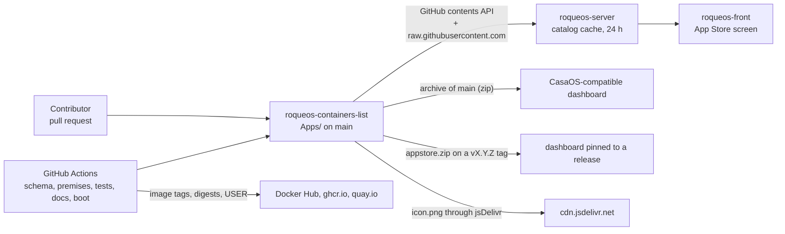
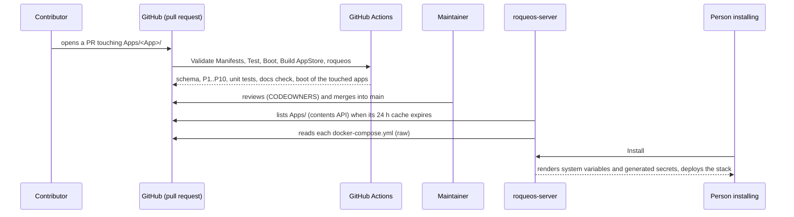
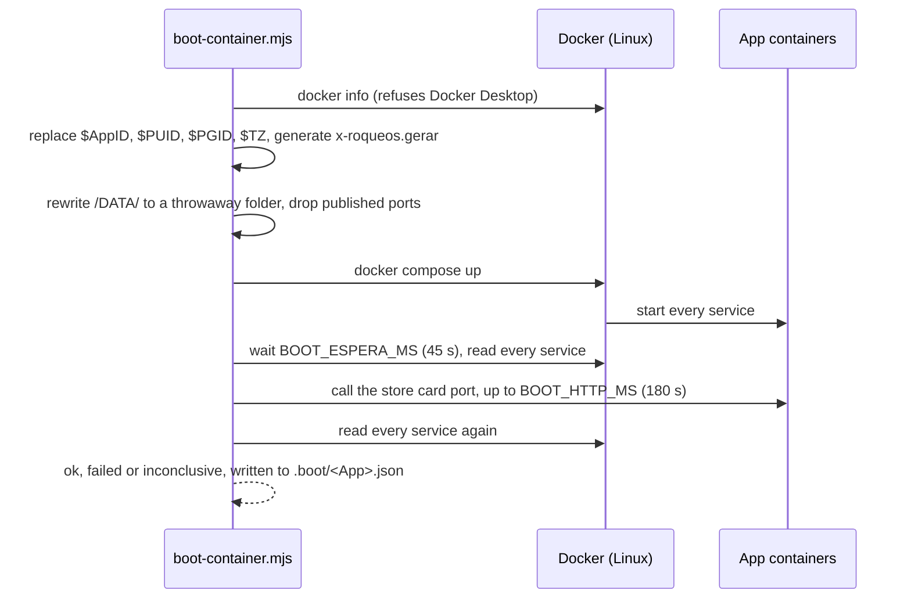

# Architecture

*Also available in [Brazilian Portuguese](pt-BR/ARQUITETURA.md).*

> **For:** whoever maintains the catalog, reviews a pull request that touches the tooling, or changes the contract with `roqueos-server`.
> **What is here:** how the catalog is put together inside: who reads it, the pieces of tooling and the file each one lives in, the paths of a change and of a boot test, the data each step writes, the decisions already taken and the limits.
> **Where to go for the rest:** every command, field and workflow in [REFERENCE.md](REFERENCE.md); what each check proves in [TESTING.md](TESTING.md); how a merge reaches the store in [HOW-IT-SHIPS.md](HOW-IT-SHIPS.md); the contract other systems read in [INTEGRATIONS.md](INTEGRATIONS.md).

## Contents

1. [The idea in one paragraph](#1-the-idea-in-one-paragraph)
2. [Context: who reads it and what it depends on](#2-context-who-reads-it-and-what-it-depends-on)
3. [Processes and where they run](#3-processes-and-where-they-run)
4. [Components](#4-components)
5. [Flow: from a pull request to the store](#5-flow-from-a-pull-request-to-the-store)
6. [Flow: the boot test](#6-flow-the-boot-test)
7. [Data and contracts](#7-data-and-contracts)
8. [Secrets](#8-secrets)
9. [Design decisions](#9-design-decisions)
10. [Known limits](#10-known-limits)
11. [How the diagrams are made](#11-how-the-diagrams-are-made)

## 1. The idea in one paragraph

The catalog is data, not a program. Each folder under [`Apps/`](../Apps/) is one app: a Docker Compose file with the store metadata under `x-casaos` and the RoqueOS extensions under `x-roqueos`, an icon, and a store card generated from the compose. Nothing here runs in production. What runs is the tooling in [`scripts/`](../scripts/), and only to answer one question before a merge: is this manifest something a stranger can install with one click and have it work? The schema answers "is it a compose", the ten premises answer "is it ready for a store", and the boot test starts it on Linux and calls the port the card promises. `main` is what the RoqueOS server reads, so the checks run on the pull request, never after.

## 2. Context: who reads it and what it depends on



| Who | What it takes from here | What happens when this repository is unavailable |
| --- | --- | --- |
| `roqueos-server` | the list of folders under `Apps/` through the GitHub contents API, then each `docker-compose.yml` from `raw.githubusercontent.com` (read on 18/11/2026 in `roqueos-server/src/modules/catalog/catalog.service.ts`) | it serves the last cache it wrote, valid for 24 hours; with no cache, the store comes up empty and logs the error |
| A CasaOS-compatible dashboard | the zip of `main` | whatever its own refresh does; not measured here |
| A dashboard pinned to a release | `appstore.zip` from a GitHub release | nothing changes: the release is frozen |
| The store screen | the icon at `cdn.jsdelivr.net/gh/roqueribeiro/roqueos-containers-list@main/Apps/<App>/icon.png` | the card shows no icon |

The tooling depends on the registries (to resolve tags and digests and to read the user an image runs as) and, for the boot test, on a Linux Docker daemon. The CI boot uses `mirror.gcr.io` as a registry mirror ([`.github/workflows/boot.yml`](../.github/workflows/boot.yml)).

## 3. Processes and where they run

There is no long running process. Everything below starts, answers and exits.

| Process | Where it runs | Started by | File |
| --- | --- | --- | --- |
| Schema check | CI and the contributor's machine | `yarn validate`, workflows `Validate Manifests` and `Build AppStore` | [`scripts/validate-manifests.mjs`](../scripts/validate-manifests.mjs) |
| The ten premises | CI and the contributor's machine | `yarn revisao`, workflow `Validate Manifests` | [`scripts/revisao-container.mjs`](../scripts/revisao-container.mjs) |
| Boot test | a Linux Docker host only; in CI, the GitHub `ubuntu-latest` runner | `yarn boot`, workflow `Boot` | [`scripts/boot-container.mjs`](../scripts/boot-container.mjs) |
| Unit tests | CI and the contributor's machine | `yarn test`, workflow `Test` | [`tests/unit/`](../tests/unit/), [`vitest.config.mjs`](../vitest.config.mjs) |
| Documentation check | CI and the contributor's machine | `yarn docs:check`, workflow `Test` | [`scripts/check-docs.mjs`](../scripts/check-docs.mjs) |
| Archive build | CI | workflow `Build AppStore` | [`.github/workflows/build-appstore.yml`](../.github/workflows/build-appstore.yml) |
| Family gate | CI | workflow `roqueos` | [`.github/workflows/roqueos.yml`](../.github/workflows/roqueos.yml) |

## 4. Components

| Component | What it does | File |
| --- | --- | --- |
| The catalog | one folder per app: `docker-compose.yml`, `icon.png`, `README.md` | [`Apps/`](../Apps/) |
| The schema | JSON Schema Draft-07 for a manifest: required keys, enums, pinned images, the shape of `x-roqueos` | [`schema/casaos-app.schema.json`](../schema/casaos-app.schema.json) |
| Validator | the schema plus the cross-field invariants the schema cannot express (`main` names a real service, `port_map` is published); keeps the frozen `UNPINNED_IMAGE_ALLOWLIST` | [`scripts/validate-manifests.mjs`](../scripts/validate-manifests.mjs) |
| Review | P1 to P10, one verdict per app, written to `.revisao/` | [`scripts/revisao-container.mjs`](../scripts/revisao-container.mjs) |
| Image user | reads the `USER` of an image straight from the registry, with no Docker and no login; the result feeds P10 | [`scripts/registry-user.mjs`](../scripts/registry-user.mjs), [`scripts/uid-imagem.mjs`](../scripts/uid-imagem.mjs), [`scripts/dados/uid-imagens.json`](../scripts/dados/uid-imagens.json) |
| Boot | renders the compose like the installer, sandboxes it, starts it, waits, calls the port | [`scripts/boot-container.mjs`](../scripts/boot-container.mjs) |
| Boot evidence | joins the boot artifacts of CI runs into one versioned file | [`scripts/evidencia-boot.mjs`](../scripts/evidencia-boot.mjs), [`evidence/boot.json`](evidence/boot.json) |
| Store card generator | writes `Apps/<App>/README.md` from the compose; upstream links come from the developer field or from a data file | [`scripts/gera-readme.mjs`](../scripts/gera-readme.mjs), [`scripts/dados/links-upstream.json`](../scripts/dados/links-upstream.json) |
| Quality page generator | writes [QUALITY.md](QUALITY.md) and its pair from the manifests, the review, the boot evidence and [RETIRED.md](RETIRED.md) | [`scripts/gera-qualidade.mjs`](../scripts/gera-qualidade.mjs) |
| Documentation gate | app counts against the disk, links and anchors, language pairs, no dashes, quality page up to date | [`scripts/check-docs.mjs`](../scripts/check-docs.mjs) |
| Mechanical fixer and audit | auto-fixes `scheme`, `mountShared` and `main`; reports translation gaps | [`scripts/fix-manifests.mjs`](../scripts/fix-manifests.mjs), [`scripts/audit-enrichment.mjs`](../scripts/audit-enrichment.mjs) |
| Import and rebrand | one-off sweeps used when importing upstream CasaOS or Big Bear apps | [`scripts/rebrand-casaos.mjs`](../scripts/rebrand-casaos.mjs), `scripts/goal18-*.mjs` |
| Store lists | categories, featured apps, recommended apps | [`category-list.json`](../category-list.json), [`featured-apps.json`](../featured-apps.json), [`recommend-list.json`](../recommend-list.json) |

## 5. Flow: from a pull request to the store



The `Boot` workflow picks the apps from the diff: every `Apps/*/docker-compose.yml` the pull request changed ([`.github/workflows/boot.yml`](../.github/workflows/boot.yml)). A pull request that only changes a store card or an icon runs the schema and the premises, not the boot.

## 6. Flow: the boot test



The waits come from the environment, with the defaults in the script: `BOOT_ESPERA_MS` 45000 and `BOOT_HTTP_MS` 180000. The longer HTTP wait exists because a fixed 45 seconds failed healthy apps still in their first migration in the scan of 15/11/2026 (comment in [`scripts/boot-container.mjs`](../scripts/boot-container.mjs)). Any HTTP status counts as an answer, including 401 and 302: what is measured is that a server is there ([`.claude/rules/padrao-da-loja.md`](../.claude/rules/padrao-da-loja.md)).

## 7. Data and contracts

**The manifest** is the contract with every reader. The smallest one the unit tests accept as valid is [`tests/fixtures/manifest-valid-minimal.yml`](../tests/fixtures/manifest-valid-minimal.yml), copied here as it is:

```yaml
name: my-app
services:
  my-app:
    image: vendor/my-app:1.0.0
    ports:
      - target: 8080
        published: '8080'
        protocol: tcp
x-casaos:
  architectures:
    - amd64
  main: my-app
  category: Productivity
  scheme: http
  port_map: '8080'
  developer: Vendor
  author: RoqueOS Team
  icon: https://example.com/icon.png
  tagline:
    en_US: A minimal valid app
  description:
    en_US: |
      A minimal valid app used as fixture in unit tests.
  title:
    en_US: My App
  index: /
```

It passes the schema. It would not pass the premises: P7 asks for `en_us` and `pt_br`, in that spelling, and P8 for an `icon.png` in the folder.

Every field is in [REFERENCE.md](REFERENCE.md), and the full contract with the server is in [INTEGRATIONS.md](INTEGRATIONS.md).

**What the tooling writes:**

| File | Written by | Versioned | Read by |
| --- | --- | --- | --- |
| `.revisao/<App>.json`, `.revisao/resumo.json` | `yarn revisao` | no (`.gitignore`) | the person running it, the quality page generator |
| `.boot/<App>.json` | `yarn boot` | no: it is true for one host and one run | the `Boot` workflow, which uploads it as the `boot` artifact |
| [`evidence/boot.json`](evidence/boot.json) | `node scripts/evidencia-boot.mjs`, from downloaded artifacts | yes | the quality page generator |
| [`scripts/dados/uid-imagens.json`](../scripts/dados/uid-imagens.json) | `yarn uid:atualiza` | yes | P10, offline, so CI and a laptop give the same verdict |
| `Apps/<App>/README.md` | `yarn readme` | yes | the store and GitHub readers |
| [QUALITY.md](QUALITY.md), [pt-BR/QUALIDADE.md](pt-BR/QUALIDADE.md) | `yarn docs:quality` | yes | readers; `yarn docs:check` fails when it is stale |

`evidence/boot.json` has `origem`, the list of `runs` (`run`, `quando`) and, per app, `resultado`, `segundos`, `run` and `quando`.

## 8. Secrets

The repository is public, so it holds no secret, and that is enforced, not hoped for. A manifest declares what it needs under `x-roqueos.gerar` and uses `${NAME}`; the RoqueOS server generates the value per install. P3 fails a literal value under a secret-looking name, a placeholder, a password inside a URL or a `command`, and any variable that is neither a system variable nor generated ([TESTING.md](TESTING.md)). The boot test generates its own throwaway values in the same formats (`segredosDoLaboratorio` in [`scripts/boot-container.mjs`](../scripts/boot-container.mjs)).

The CI has one secret of its own, `HARNESS_TOKEN`, used only by the `roqueos` workflow to check out the private family harness ([`.github/workflows/roqueos.yml`](../.github/workflows/roqueos.yml)). The other workflows run with `contents: read` and no secret, so they work on a pull request from a fork.

## 9. Design decisions

| Decided | Refused alternative | Why | Date |
| --- | --- | --- | --- |
| The store reads `main`; a release is optional | the server pinning `appstore.zip` from a tag | RoqueOS reads `main` through the contents API today; no semver tag has been cut ([HOW-IT-SHIPS.md](HOW-IT-SHIPS.md)) | in force on 18/11/2026 |
| Secrets are generated per install (`x-roqueos.gerar`) | `change-me-on-first-boot` plus a tip asking to change it | on 17/11/2026, 62 apps carried a literal JWT, session key or database password, the same on every install; nobody changes what the install does not ask for | 17/11/2026 |
| Boot only on Linux | booting on Docker Desktop | the same broken manifest is `Up` on macOS and `Restarting (1)` on Linux, measured on the same day | 14/09/2026 |
| P10 and the boot test exist | trusting the nine static premises | Grafana passed all nine and never started: the bind is created `root:root 0755` and the image writes as uid 472 | 14/09/2026 |
| A data-folder permission problem is fixed with `user: "0:0"` or a seed | a named volume, or `user:` with the image's uid | measured on a Linux daemon: `user: "472"` still fails, a named volume moves the data out of `/DATA/AppData` and breaks the backup convention ([`scripts/goal18-permissao.mjs`](../scripts/goal18-permissao.mjs)) | 14/09/2026 |
| An image with no version tag is pinned by digest | keeping `:latest`, or inventing a tag | a digest is reproducible and makes an update deliberate ([`scripts/goal18-fixa-digest.mjs`](../scripts/goal18-fixa-digest.mjs)) | Goal 18 |
| Language keys are `en_us` and `pt_br`, lower case | accepting `en_US`, `en_GB`, `pt_PT` | the server reads one spelling; 44 apps showed the folder name and 56 the fallback description when it did not match ([`scripts/goal18-normaliza-idioma.mjs`](../scripts/goal18-normaliza-idioma.mjs)) | 14/09/2026 |
| Thumbnails and screenshots are not checked | keeping them in P8 | the server does not read them and the store does not draw them; a gate that checks the invisible teaches people to ignore gates | Goal 18 |
| Elevated access is declared, not removed | removing `privileged` and host network | the rule is to write down why in `x-roqueos.motivo`, not to break apps that need it | 14/09/2026 |
| Yarn only | npm | the lockfile is `yarn.lock`, and the family guard reads the package manager from the repository's manifest | in force |

## 10. Known limits

- **The weekly boot does not finish**: it runs the whole catalog in sequence and the job stops at 90 minutes ([`.github/workflows/boot.yml`](../.github/workflows/boot.yml)). Most apps are proven only when a pull request touches them.
- **The lab runs `docker compose up`, not the RoqueOS installer.** The installer was proven on its own (`roqueos-server` 1.38.0 on 17/11/2026), not in this pipeline.
- **Only amd64 is booted.** arm64 is declared, not started, and no check compares it with what the image publishes.
- **No upgrade test**, no login test, no check that a screen opens.
- **The server lists `Apps/` through the unauthenticated GitHub contents API.** How it behaves under the API rate limit was not measured here.
- **Some apps use `localhost`** where they need the server address (Baserow, Healthchecks, Rallly), until the installer offers that variable.
- **`CLAUDE.md` still says the server fetches `appstore.zip` on boot**; the server code read on 18/11/2026 lists `Apps/` through the contents API and accepts a zip only when a store URL ends in `.zip`.

## 11. How the diagrams are made

Every diagram on this page is Mermaid inside the Markdown, rendered by GitHub. The source is the text above; the Portuguese pair carries the same diagrams with translated labels. There is no image to regenerate.
