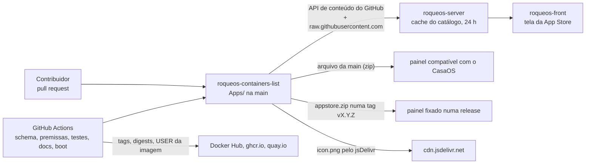
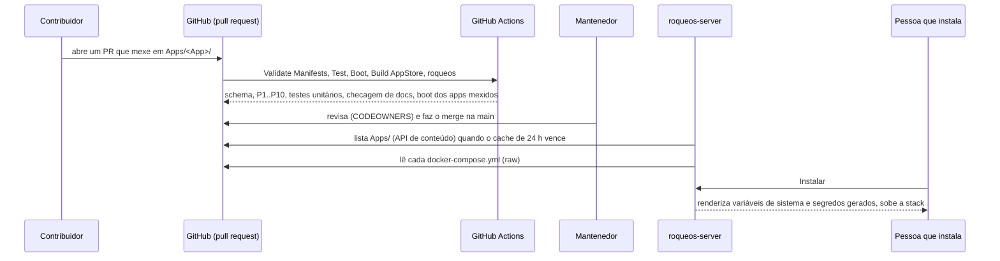
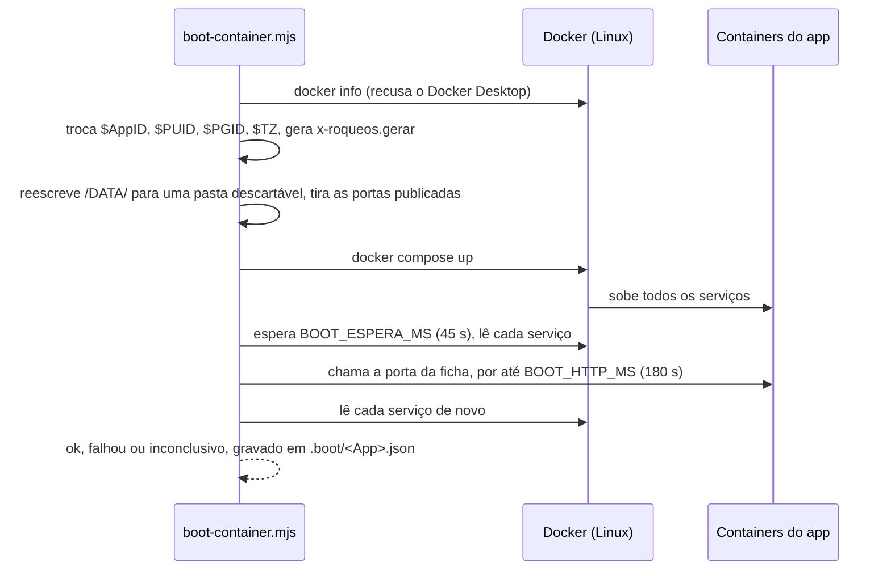

# Arquitetura

*Tradução de [ARCHITECTURE.md](../ARCHITECTURE.md), a versão principal, em inglês. Se as duas divergirem, vale a em inglês.*

> **Para quem:** quem mantém o catálogo, revisa um pull request que mexe nas ferramentas, ou muda o contrato com o `roqueos-server`.
> **O que tem aqui:** como o catálogo é montado por dentro: quem lê, as peças de ferramenta e o arquivo de cada uma, o caminho de uma mudança e de um teste de boot, o que cada passo grava, as decisões já tomadas e os limites.
> **Onde ir para o resto:** cada comando, campo e workflow na [REFERENCIA.md](REFERENCIA.md); o que cada checagem prova nos [CRITERIOS-DE-TESTE.md](CRITERIOS-DE-TESTE.md); como um merge chega à loja no [COMO-CHEGA.md](COMO-CHEGA.md); o contrato que outros sistemas leem nas [INTEGRACOES.md](INTEGRACOES.md).

## Sumário

1. [A ideia em um parágrafo](#1-a-ideia-em-um-parágrafo)
2. [Contexto: quem lê e do que depende](#2-contexto-quem-lê-e-do-que-depende)
3. [Processos e onde rodam](#3-processos-e-onde-rodam)
4. [Componentes](#4-componentes)
5. [Fluxo: do pull request à loja](#5-fluxo-do-pull-request-à-loja)
6. [Fluxo: o teste de boot](#6-fluxo-o-teste-de-boot)
7. [Dados e contratos](#7-dados-e-contratos)
8. [Segredos](#8-segredos)
9. [Decisões de design](#9-decisões-de-design)
10. [Limites conhecidos](#10-limites-conhecidos)
11. [Como os diagramas são feitos](#11-como-os-diagramas-são-feitos)

## 1. A ideia em um parágrafo

O catálogo é dado, não programa. Cada pasta em [`Apps/`](../../Apps/) é um app: um arquivo Docker Compose com os metadados da loja em `x-casaos` e as extensões do RoqueOS em `x-roqueos`, um ícone, e uma ficha de loja gerada a partir do compose. Nada aqui roda em produção. O que roda são as ferramentas em [`scripts/`](../../scripts/), e só para responder uma pergunta antes do merge: este manifesto é algo que um estranho instala com um clique e funciona? O schema responde "é um compose", as dez premissas respondem "está pronto para uma loja", e o teste de boot sobe o app em Linux e chama a porta que a ficha promete. A `main` é o que o servidor do RoqueOS lê, então as checagens rodam no pull request, nunca depois.

## 2. Contexto: quem lê e do que depende



| Quem | O que pega daqui | O que acontece quando este repositório está fora do ar |
| --- | --- | --- |
| `roqueos-server` | a lista de pastas de `Apps/` pela API de conteúdo do GitHub, depois cada `docker-compose.yml` em `raw.githubusercontent.com` (lido em 18/11/2026 em `roqueos-server/src/modules/catalog/catalog.service.ts`) | serve o último cache que gravou, válido por 24 horas; sem cache, a loja sobe vazia e registra o erro no log |
| Um painel compatível com o CasaOS | o zip da `main` | o que a atualização do próprio painel fizer; não medido aqui |
| Um painel fixado numa release | o `appstore.zip` de uma release do GitHub | nada muda: a release é congelada |
| A tela da loja | o ícone em `cdn.jsdelivr.net/gh/roqueribeiro/roqueos-containers-list@main/Apps/<App>/icon.png` | a ficha aparece sem ícone |

As ferramentas dependem dos registries (para resolver tag e digest e para ler o usuário com que a imagem roda) e, no teste de boot, de um daemon Docker em Linux. O boot do CI usa o `mirror.gcr.io` como espelho de registry ([`.github/workflows/boot.yml`](../../.github/workflows/boot.yml)).

## 3. Processos e onde rodam

Não existe processo de longa duração. Tudo abaixo começa, responde e sai.

| Processo | Onde roda | Quem dispara | Arquivo |
| --- | --- | --- | --- |
| Checagem de schema | CI e a máquina de quem contribui | `yarn validate`, workflows `Validate Manifests` e `Build AppStore` | [`scripts/validate-manifests.mjs`](../../scripts/validate-manifests.mjs) |
| As dez premissas | CI e a máquina de quem contribui | `yarn revisao`, workflow `Validate Manifests` | [`scripts/revisao-container.mjs`](../../scripts/revisao-container.mjs) |
| Teste de boot | só host Docker Linux; no CI, o runner `ubuntu-latest` do GitHub | `yarn boot`, workflow `Boot` | [`scripts/boot-container.mjs`](../../scripts/boot-container.mjs) |
| Testes unitários | CI e a máquina de quem contribui | `yarn test`, workflow `Test` | [`tests/unit/`](../../tests/unit/), [`vitest.config.mjs`](../../vitest.config.mjs) |
| Checagem da documentação | CI e a máquina de quem contribui | `yarn docs:check`, workflow `Test` | [`scripts/check-docs.mjs`](../../scripts/check-docs.mjs) |
| Montagem do arquivo | CI | workflow `Build AppStore` | [`.github/workflows/build-appstore.yml`](../../.github/workflows/build-appstore.yml) |
| Gate da família | CI | workflow `roqueos` | [`.github/workflows/roqueos.yml`](../../.github/workflows/roqueos.yml) |

## 4. Componentes

| Componente | O que faz | Arquivo |
| --- | --- | --- |
| O catálogo | uma pasta por app: `docker-compose.yml`, `icon.png`, `README.md` | [`Apps/`](../../Apps/) |
| O schema | JSON Schema Draft-07 do manifesto: chaves obrigatórias, enums, imagem fixada, a forma de `x-roqueos` | [`schema/casaos-app.schema.json`](../../schema/casaos-app.schema.json) |
| Validador | o schema mais as invariantes entre campos que o schema não expressa (`main` nomeia um serviço real, `port_map` está publicada); guarda a `UNPINNED_IMAGE_ALLOWLIST` congelada | [`scripts/validate-manifests.mjs`](../../scripts/validate-manifests.mjs) |
| Revisão | P1 a P10, um veredito por app, gravado em `.revisao/` | [`scripts/revisao-container.mjs`](../../scripts/revisao-container.mjs) |
| Usuário da imagem | lê o `USER` de uma imagem direto no registry, sem Docker e sem login; o resultado alimenta a P10 | [`scripts/registry-user.mjs`](../../scripts/registry-user.mjs), [`scripts/uid-imagem.mjs`](../../scripts/uid-imagem.mjs), [`scripts/dados/uid-imagens.json`](../../scripts/dados/uid-imagens.json) |
| Boot | renderiza o compose como o instalador, isola numa caixa, sobe, espera, chama a porta | [`scripts/boot-container.mjs`](../../scripts/boot-container.mjs) |
| Evidência de boot | junta os artefatos de boot dos runs do CI num arquivo versionado | [`scripts/evidencia-boot.mjs`](../../scripts/evidencia-boot.mjs), [`evidence/boot.json`](../evidence/boot.json) |
| Gerador da ficha da loja | escreve `Apps/<App>/README.md` a partir do compose; o link do upstream vem do campo developer ou de um arquivo de dados | [`scripts/gera-readme.mjs`](../../scripts/gera-readme.mjs), [`scripts/dados/links-upstream.json`](../../scripts/dados/links-upstream.json) |
| Gerador da página de qualidade | escreve a [QUALIDADE.md](QUALIDADE.md) e o par a partir dos manifestos, da revisão, da evidência de boot e do [APOSENTADOS.md](APOSENTADOS.md) | [`scripts/gera-qualidade.mjs`](../../scripts/gera-qualidade.mjs) |
| Gate da documentação | contagem de apps contra o disco, links e âncoras, pares de idioma, nenhum travessão, página de qualidade em dia | [`scripts/check-docs.mjs`](../../scripts/check-docs.mjs) |
| Corretor mecânico e auditoria | corrige sozinho `scheme`, `mountShared` e `main`; relata lacunas de tradução | [`scripts/fix-manifests.mjs`](../../scripts/fix-manifests.mjs), [`scripts/audit-enrichment.mjs`](../../scripts/audit-enrichment.mjs) |
| Importação e rebrand | varreduras pontuais usadas ao importar apps do CasaOS ou do Big Bear | [`scripts/rebrand-casaos.mjs`](../../scripts/rebrand-casaos.mjs), `scripts/goal18-*.mjs` |
| Listas da loja | categorias, apps em destaque, apps recomendados | [`category-list.json`](../../category-list.json), [`featured-apps.json`](../../featured-apps.json), [`recommend-list.json`](../../recommend-list.json) |

## 5. Fluxo: do pull request à loja



O workflow `Boot` escolhe os apps pelo diff: todo `Apps/*/docker-compose.yml` que o pull request mudou ([`.github/workflows/boot.yml`](../../.github/workflows/boot.yml)). Um pull request que só muda uma ficha ou um ícone roda o schema e as premissas, não o boot.

## 6. Fluxo: o teste de boot



As esperas vêm do ambiente, com os padrões do script: `BOOT_ESPERA_MS` 45000 e `BOOT_HTTP_MS` 180000. A espera de HTTP maior existe porque 45 segundos fixos reprovavam apps sadios ainda na primeira migração na varredura de 15/11/2026 (comentário em [`scripts/boot-container.mjs`](../../scripts/boot-container.mjs)). Qualquer status HTTP conta como resposta, inclusive 401 e 302: o que se mede é que há um servidor ali ([`.claude/rules/padrao-da-loja.md`](../../.claude/rules/padrao-da-loja.md)).

## 7. Dados e contratos

**O manifesto** é o contrato com todo leitor. O menor que os testes unitários aceitam como válido é o [`tests/fixtures/manifest-valid-minimal.yml`](../../tests/fixtures/manifest-valid-minimal.yml), copiado aqui como está:

```yaml
name: my-app
services:
  my-app:
    image: vendor/my-app:1.0.0
    ports:
      - target: 8080
        published: '8080'
        protocol: tcp
x-casaos:
  architectures:
    - amd64
  main: my-app
  category: Productivity
  scheme: http
  port_map: '8080'
  developer: Vendor
  author: RoqueOS Team
  icon: https://example.com/icon.png
  tagline:
    en_US: A minimal valid app
  description:
    en_US: |
      A minimal valid app used as fixture in unit tests.
  title:
    en_US: My App
  index: /
```

Ele passa no schema. Não passaria nas premissas: a P7 pede `en_us` e `pt_br`, nessa grafia, e a P8 um `icon.png` na pasta.

Cada campo está na [REFERENCIA.md](REFERENCIA.md), e o contrato inteiro com o servidor nas [INTEGRACOES.md](INTEGRACOES.md).

**O que as ferramentas gravam:**

| Arquivo | Quem grava | Versionado | Quem lê |
| --- | --- | --- | --- |
| `.revisao/<App>.json`, `.revisao/resumo.json` | `yarn revisao` | não (`.gitignore`) | quem rodou, o gerador da página de qualidade |
| `.boot/<App>.json` | `yarn boot` | não: vale para um host e um run | o workflow `Boot`, que sobe como o artefato `boot` |
| [`evidence/boot.json`](../evidence/boot.json) | `node scripts/evidencia-boot.mjs`, a partir dos artefatos baixados | sim | o gerador da página de qualidade |
| [`scripts/dados/uid-imagens.json`](../../scripts/dados/uid-imagens.json) | `yarn uid:atualiza` | sim | a P10, offline, para o CI e um notebook darem o mesmo veredito |
| `Apps/<App>/README.md` | `yarn readme` | sim | a loja e quem lê no GitHub |
| [QUALITY.md](../QUALITY.md), [QUALIDADE.md](QUALIDADE.md) | `yarn docs:quality` | sim | os leitores; o `yarn docs:check` reprova quando está velha |

O `evidence/boot.json` tem `origem`, a lista de `runs` (`run`, `quando`) e, por app, `resultado`, `segundos`, `run` e `quando`.

## 8. Segredos

O repositório é público, então não guarda segredo, e isso é cobrado, não esperado. Um manifesto declara o que precisa em `x-roqueos.gerar` e usa `${NOME}`; o servidor do RoqueOS gera o valor por instalação. A P3 reprova valor literal sob nome de segredo, placeholder, senha dentro de URL ou de `command`, e qualquer variável que não seja de sistema nem gerada ([CRITERIOS-DE-TESTE.md](CRITERIOS-DE-TESTE.md)). O teste de boot gera os próprios valores descartáveis nos mesmos formatos (`segredosDoLaboratorio` em [`scripts/boot-container.mjs`](../../scripts/boot-container.mjs)).

O CI tem um segredo próprio, o `HARNESS_TOKEN`, usado só pelo workflow `roqueos` para trazer o harness privado da família ([`.github/workflows/roqueos.yml`](../../.github/workflows/roqueos.yml)). Os outros workflows rodam com `contents: read` e sem segredo, então funcionam em pull request vindo de fork.

## 9. Decisões de design

| Decidido | Alternativa recusada | Por quê | Data |
| --- | --- | --- | --- |
| A loja lê a `main`; release é opcional | o servidor fixar o `appstore.zip` de uma tag | o RoqueOS lê a `main` pela API de conteúdo hoje; nenhuma tag semver foi criada ([COMO-CHEGA.md](COMO-CHEGA.md)) | em vigor em 18/11/2026 |
| Segredo é gerado por instalação (`x-roqueos.gerar`) | `change-me-on-first-boot` mais uma dica pedindo para trocar | em 17/11/2026, 62 apps traziam JWT, chave de sessão ou senha de banco literal, igual em toda instalação; ninguém troca o que a instalação não pede | 17/11/2026 |
| Boot só em Linux | bootar no Docker Desktop | o mesmo manifesto quebrado fica `Up` no macOS e `Restarting (1)` no Linux, medido no mesmo dia | 14/09/2026 |
| Existem a P10 e o teste de boot | confiar nas nove premissas estáticas | o Grafana passou nas nove e nunca subiu: o bind nasce `root:root 0755` e a imagem escreve como uid 472 | 14/09/2026 |
| Problema de permissão da pasta de dados se resolve com `user: "0:0"` ou semente | volume nomeado, ou `user:` com o uid da imagem | medido num daemon Linux: `user: "472"` continua falhando, volume nomeado tira o dado de `/DATA/AppData` e quebra a convenção de backup ([`scripts/goal18-permissao.mjs`](../../scripts/goal18-permissao.mjs)) | 14/09/2026 |
| Imagem sem tag de versão é fixada por digest | manter `:latest`, ou inventar uma tag | o digest é reproduzível e torna a atualização deliberada ([`scripts/goal18-fixa-digest.mjs`](../../scripts/goal18-fixa-digest.mjs)) | Goal 18 |
| As chaves de idioma são `en_us` e `pt_br`, minúsculas | aceitar `en_US`, `en_GB`, `pt_PT` | o servidor lê uma grafia só; 44 apps mostravam o nome da pasta e 56 a descrição de fallback quando não batia ([`scripts/goal18-normaliza-idioma.mjs`](../../scripts/goal18-normaliza-idioma.mjs)) | 14/09/2026 |
| Thumbnail e screenshot não são checados | mantê-los na P8 | o servidor não os lê e a loja não os desenha; gate que cobra o invisível ensina a ignorar gate | Goal 18 |
| Acesso elevado é declarado, não removido | tirar `privileged` e rede de host | a regra é escrever o porquê em `x-roqueos.motivo`, não quebrar app que precisa | 14/09/2026 |
| Só Yarn | npm | o lockfile é o `yarn.lock`, e a guarda da família lê o gerenciador de pacotes do manifesto do repositório | em vigor |

## 10. Limites conhecidos

- **O boot semanal não termina**: roda o catálogo inteiro em sequência e o job para em 90 minutos ([`.github/workflows/boot.yml`](../../.github/workflows/boot.yml)). A maioria dos apps só é provada quando um pull request mexe neles.
- **O laboratório roda `docker compose up`, não o instalador do RoqueOS.** O instalador foi provado à parte (`roqueos-server` 1.38.0 em 17/11/2026), não neste pipeline.
- **Só amd64 é bootado.** arm64 é declarado, não ligado, e nenhuma checagem compara com o que a imagem publica.
- **Sem teste de atualização**, sem teste de login, sem checagem de que a tela abre.
- **O servidor lista `Apps/` pela API de conteúdo do GitHub sem autenticação.** Como ele se comporta no limite de requisições da API não foi medido aqui.
- **Alguns apps usam `localhost`** onde precisam do endereço do servidor (Baserow, Healthchecks, Rallly), até o instalador oferecer essa variável.
- **O `CLAUDE.md` ainda diz que o servidor baixa o `appstore.zip` ao subir**; o código do servidor lido em 18/11/2026 lista `Apps/` pela API de conteúdo e só aceita zip quando a URL de uma loja termina em `.zip`.

## 11. Como os diagramas são feitos

Todo diagrama desta página é Mermaid dentro do Markdown, desenhado pelo GitHub. A fonte é o texto acima; o par em inglês carrega os mesmos diagramas com os rótulos no idioma dele. Não há imagem para regerar.
